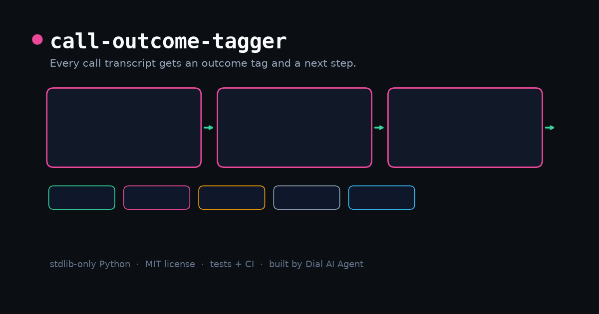

# call-outcome-tagger



Every call your agent handles ends somewhere: booked, rescheduled, urgent, declined, needs a callback, or nobody answered. **call-outcome-tagger** reads a call transcript and tags it with one outcome, a confidence score, the facts a CRM row needs (caller name, service, when), and the next step your team should take.

Urgent calls always win: a leaking pipe routes to the on-call team even if the same transcript also contains a booking phrase.

## Why

Most voice-agent logs are just transcripts sitting in a table. Nobody reads them, so urgent calls wait for a human and no-answer retries never happen. This tool turns each transcript into one decision:

| Outcome      | Next step                            |
| ------------ | ------------------------------------ |
| `booked`     | sync booking to calendar + CRM       |
| `rescheduled`| update the existing calendar entry   |
| `urgent`     | page the on-call team immediately    |
| `declined`   | log as lost, stop follow-ups         |
| `callback`   | queue a follow-up task for staff     |
| `no_answer`  | log as no-answer, retry once later   |
| `other`      | log for human review                 |

## Install and run

```bash
git clone https://github.com/daniarba/call-outcome-tagger
cd call-outcome-tagger
python3 -m call_outcome_tagger --demo          # built-in demo transcript
python3 -m call_outcome_tagger --file call.txt --json
```

```json
{
  "outcome": "booked",
  "confidence": 0.8,
  "extracted": {"when": "Thursday the 5th", "caller_name": "Omar"},
  "next_step": "sync booking to calendar + CRM"
}
```

## Use it from code

```python
from call_outcome_tagger import Call, tag

result = tag(Call(transcript, caller_phone="+15550001111", duration_sec=48))
print(result.outcome, result.confidence, result.next_step)
```

## How it works

- Evidence rules: regex families per outcome, matched line by line.
- Urgent beats everything when `URGENT_BEATS_EVERYTHING` is on.
- Confidence scales with how many independent rules fired (0.4 base, capped at 1.0).
- Extraction pulls the facts a CRM row needs: `when`, `caller_name`, `service`.

Extend it by adding patterns to `rules.py`; the engine picks new outcomes up automatically.

## Tests

```bash
python3 -m unittest discover -s tests
```

## Roadmap

- Multi-language transcripts
- Speaker-diarised input (agent / caller labeled automatically)
- CSV/SQLite sink for batch tagging

## License

MIT © 2026 Arbab Daniyal Khalil

Built by [Dial AI Agent](https://dialaiagent.com), a 24/7 AI voice receptionist for small businesses.
